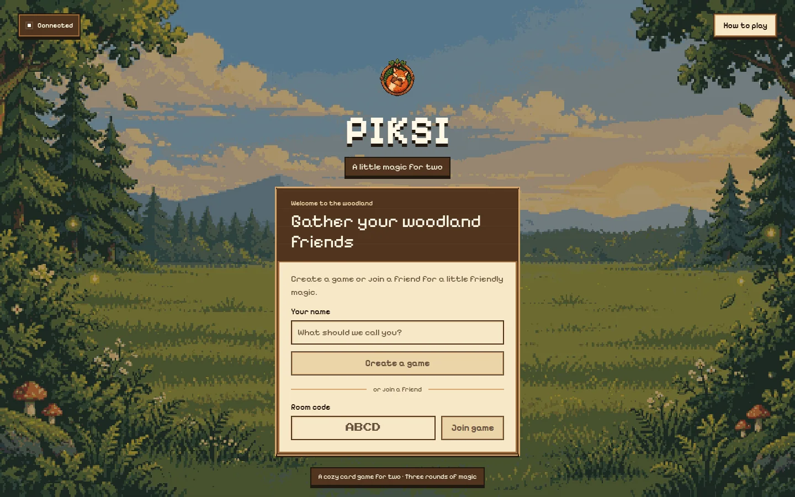
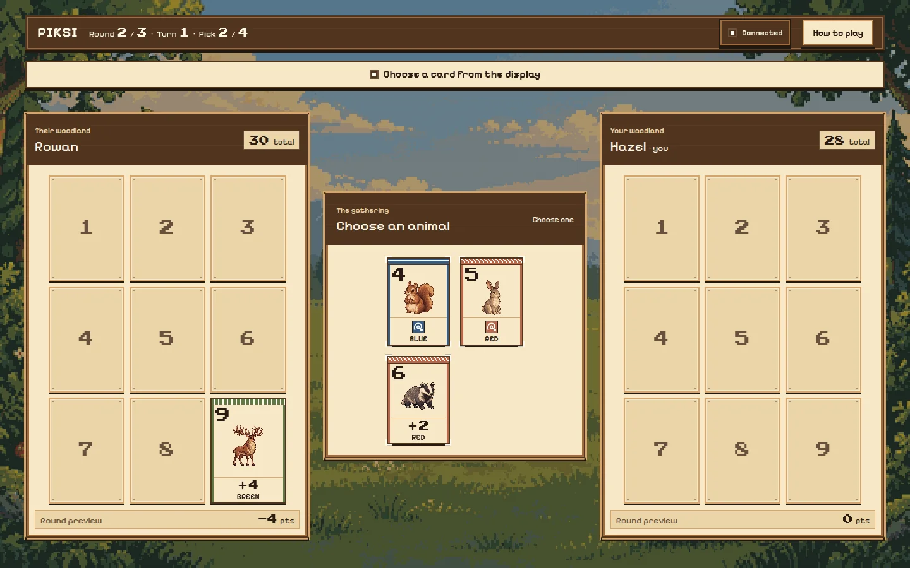
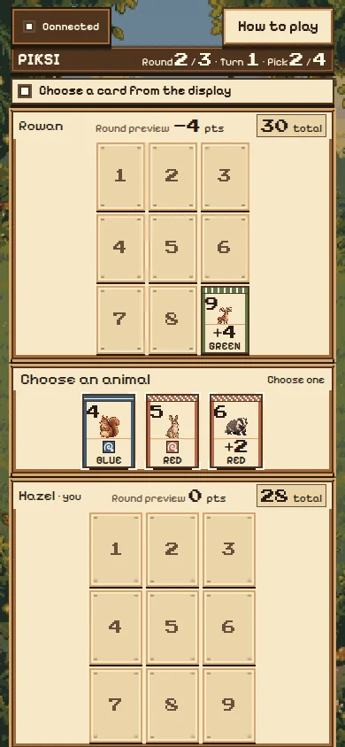

# Piksi

**A cozy, two-player online card game with woodland pixel art — an unofficial web adaptation of Pixies.**

[Play the live demo](https://piksi.quz.ma) · [How to play](#how-to-play) · [Run locally](#local-development) · [Self-host](#self-hosting)

[](https://github.com/DarkoKuzmanovic/piksi/actions/workflows/ci.yml)
[](LICENSE)

> **Unofficial fan project.** Piksi is not affiliated with, endorsed by, or sponsored by the Pixies publisher or creators. Pixies and its original game materials belong to their respective rights holders. The MIT license applies to this project's code only, not to the commercial rulebook or other third-party content.
>
> **Publication status:** GitHub metadata and CI are prepared locally; the CI badge becomes useful after publication. The repository still contains the publisher's rulebook PDF and derived rule documents, including in git history. These need a rights review and removal/history cleanup before any public push; the fan-project notice is not permission to redistribute them.

## Features

- Exactly two players, connected through a shareable room code or invite link; no account needed.
- Server-authoritative rules, card drafting, placement choices and automatic scoring across three rounds.
- Reconnect and resume support for temporary disconnects, plus a mutual-consent rematch.
- Responsive desktop and mobile layouts, an in-game field guide, and round-by-round score breakdowns.
- Original AI-generated woodland animal artwork, a cozy 8-bit visual system and patterned color bands.
- Keyboard focus states and accessible dialog controls.
- Web app manifest, install icons and standalone display metadata. Online connectivity is required; this is not an offline game.

## Screenshots

Captured from the current woodland UI with fictional player names. The lobby screenshot is from the live demo; gameplay screenshots reuse the current local smoke captures.





<p align="center">
  
</p>

## How to play

1. Enter a display name, create a game, and send the invite link or room code to a friend. Your friend enters a name and joins.
2. Take turns choosing cards from the shared display. A card's number determines its space in your 3 × 3 board.
3. Pair cards to validate spaces and choose which animal stays face up. Some placements instead let you put a card face down in an empty space.
4. Score validated numbers, spirals and your largest connected color group; crosses lose points. Color-group multipliers grow over the three rounds.
5. The highest total after round three wins. Both players must agree to a rematch.

Open **How to play** in the app for placement details, symbol examples and the full scoring explanation. This short introduction is not a redistribution of the publisher's rulebook.

## Tech stack

| Layer | Tools |
| --- | --- |
| Game engine | Pure TypeScript, shared by server and client |
| Backend | Node.js, Fastify, WebSocket, tsx |
| Frontend | React, Vite, TypeScript, Zustand, Tailwind CSS |
| Tests | Vitest |
| Delivery | Multi-stage Docker image, Docker Compose |
| Typography | Pixelify Sans and Press Start 2P, loaded from Google Fonts |

## Local development

### Requirements

- Node.js **22.12 or newer**; Node 22 LTS is used in CI and Docker.
- npm, and two terminals for the development servers.

Install dependencies from the repository root (there are three independent npm packages):

```sh
npm ci
npm --prefix backend ci
npm --prefix frontend ci --legacy-peer-deps
```

The frontend currently needs `--legacy-peer-deps` because the Tailwind Vite plugin's peer range does not include the project's Vite 8 version.

Start the backend in one terminal:

```sh
cd backend
PORT=3101 npm run dev
```

Start the frontend in another terminal:

```sh
cd frontend
VITE_WS_TARGET=ws://localhost:3101 npm run dev -- --host 127.0.0.1 --port 5174
```

Open **http://127.0.0.1:5174** in two browser tabs or windows to play. These explicit ports avoid an existing service on port 3000. The server defaults to port 3000 when `PORT` is unset; the frontend's default WebSocket proxy target is `ws://localhost:3000`.

### Tests and production frontend build

From the repository root:

```sh
npm test
npm --prefix frontend run build
```

The suite covers the shared engine and backend behavior. CI installs dependencies, runs the tests and builds the frontend; it does not deploy.

### Configuration

| Setting | Where | Default / purpose |
| --- | --- | --- |
| `PORT` | Backend environment | `3000`; HTTP and WebSocket listener |
| `FRONTEND_DIST` | Backend environment | Local `frontend/dist` directory; set automatically inside Docker |
| `VITE_WS_TARGET` | Vite development environment | `ws://localhost:3000`; development proxy target for `/ws` |

The production client connects to `/ws` on the same host as the page. No API keys or database are needed.

## Self-hosting

Use the generic [`compose.selfhost.yml`](compose.selfhost.yml), not the maintainer-specific deployment script or default Compose network configuration:

```sh
PIKSI_PORT=3102 docker compose -f compose.selfhost.yml up --build -d
```

It builds the frontend and backend into one Node container and exposes the app only on **http://127.0.0.1:3102** with the command above. Omit `PIKSI_PORT` to use the default port 3000, or choose another unused port. Put your own HTTPS reverse proxy or tunnel in front of that address and forward WebSocket upgrades for `/ws`. For a containerized proxy, adapt the Docker network rather than exposing the app port publicly.

There are no persistent volumes or database: rooms and matches live in server memory, so restarting the container ends them. Use one application instance unless you first implement shared room state and connection routing.

`sync.sh`, the default `docker-compose.yml`, and deployment notes describe the maintainer's existing infrastructure; they are not portable self-hosting instructions and require privacy cleanup before publication.

## Project layout

```text
shared/               Pure TypeScript game engine, deck, scoring and WS protocol
backend/              Fastify server, WebSocket actions and room/session management
frontend/             React client and public woodland art/icons
tests/                Engine and backend tests
docs/design/          Editable design source, assets and reference exports
docs/screenshots/     Compressed screenshots used by this README
docs/superpowers/     Design specifications and implementation plans
Dockerfile            Multi-stage production image
compose.selfhost.yml  Generic loopback-only local/self-hosted container
```

## Privacy and third-party notices

- No accounts are required. Choose a nickname rather than a real name; your opponent sees it. Room codes and invite links allow another player to join, so share them privately.
- Game state, player names and resume sessions are held in server memory. Resume tokens are stored in the browser tab's `sessionStorage`; the server also emits normal HTTP access logs, which can contain network metadata and request URLs.
- Google Fonts is contacted at runtime to load **Pixelify Sans** and **Press Start 2P**, which are licensed under the SIL Open Font License. Font requests disclose ordinary connection metadata to Google. Self-host the fonts if you need to avoid those requests.
- Woodland artwork was generated specifically for this project using **gpt-image-2**. It does not use the publisher's original card illustrations. See [the asset guide](docs/asset-guide.md) and [asset manifest](frontend/public/assets/MANIFEST.md) for provenance.
- `PIXIES_rulebook_EN_official.pdf` is publisher material, **not MIT-licensed**. The derived rule guides and deck manifest also require a rights review. Their current presence must not be treated as redistribution permission.

## License

The project **code** is available under the [MIT License](LICENSE), copyright © 2026 Darko Kuzmanovic. That license does not grant rights in third-party trademarks, game materials, fonts, artwork, or documentation. Third-party materials retain their own rights and licenses; no broader artwork or documentation license is asserted here.
